<div align="center">


# Nexo · Sistema de Facturación

### Factura. Firma. Cobra.

**Facturación para trabajadores por cuenta propia en Cuba: clientes, contratos, facturas, conformidad del cliente y registro fiscal.**
**Web instalable (PWA) y servidor propio con HTTPS: tus datos se quedan en tu equipo.**

🌐 **[Sitio del proyecto](https://yhquintero.github.io/Sistema_de_Facturacion/) · [Operación segura](docs/OPERACION-SEGURA.md) · [Alcance fiscal ONAT](docs/ONAT-CUBA.md) · [Seguridad](SECURITY.md) · [Novedades](CHANGELOG.md)**

[](https://github.com/yhquintero/Sistema_de_Facturacion/actions/workflows/ci.yml)
[](CHANGELOG.md)
[](#-cómo-funciona)
[](#-preguntas-frecuentes)
[](#-requisitos)
[](tsconfig.json)
[](src/)
[](server/)
[](#-seguridad)
[](LICENSE)

[Resumen](#-resumen) · [Cómo funciona](#-cómo-funciona) · [Funciones](#-funciones) · [Capturas](#-capturas) · [Requisitos](#-requisitos) · [Inicio rápido](#-inicio-rápido) · [Roles](#-roles-y-permisos) · [Seguridad](#-seguridad) · [Documentación](#-documentación) · [Preguntas frecuentes](#-preguntas-frecuentes) · [Licencia](#-licencia)

</div>

<p align="center">
  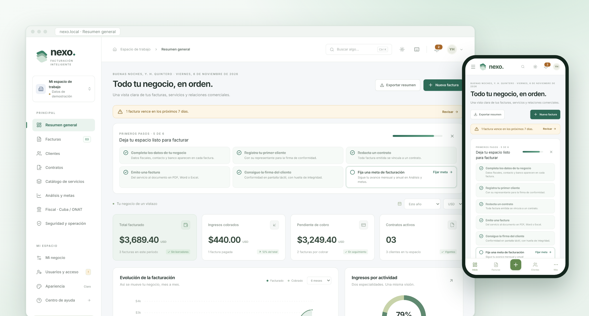
</p>

> [!TIP]
> **¿Primera vez?** Arranca con el [panel de PowerShell](#-inicio-rápido): instala lo necesario, pide la contraseña
> del administrador, activa HTTPS y abre el navegador. Dentro, la lista **Primeros pasos** del Resumen te guía:
> datos del negocio → primer cliente → contrato → factura → firma → meta.

> [!IMPORTANT]
> **Nexo es software propietario.** El código es visible en GitHub, pero usarlo en un negocio, copiarlo, modificarlo o distribuirlo requiere una **licencia de uso** del titular. Consulta [LICENSE](LICENSE) y la sección [Licencia](#-licencia).

> [!WARNING]
> **Endurecimiento técnico no equivale a certificación ni aceptación de la ONAT.** La DJ-08 oficial y la presentación están **bloqueadas** hasta verificar la plantilla, el instructivo y las reglas del ejercicio. La demostración contiene datos sintéticos: no alojes información real en Arena, GitHub ni en una nube extranjera sin revisar la residencia de datos y las excepciones legales.

---

## 🧭 Resumen

Nexo ordena el ciclo completo de un servicio profesional: **Suministrador → Cliente → Contrato → Factura → Conformidad**. Cada factura nace de un contrato, se exporta en PDF, Word o Excel en el tamaño de hoja que pida el cliente, y se cierra con la firma de conformidad del Cliente Final. Los cobros pasan al registro fiscal para preparar la información de la ONAT.

| Ficha del proyecto | Detalle |
|---|---|
| **Qué es** | Sistema de facturación con contratos, firma de conformidad, análisis comercial y preparación fiscal. |
| **Para quién** | Trabajadores por cuenta propia (TCP) y personas naturales en Cuba que prestan servicios informáticos y técnicos. Ingresos 2026. |
| **Cómo está hecho** | React 19 + TypeScript en la Web; Express 5 + SQLite (WAL) en el servidor; Zod y decimal.js para validar e importar sin errores de redondeo. |
| **Dónde corre** | En tu propio equipo (Windows con panel PowerShell, Linux o Docker). Se usa desde el navegador del PC, la tablet o el móvil de la red local. |
| **Cómo se usa** | Cuentas personales con cuatro roles, verificación en dos pasos y HTTPS. Instalable como app (PWA). |
| **Estado** | Versión 1.1.0. CI en verde en Linux y Windows. Ver [verificaciones y límites](docs/VERIFICACION.md). |
| **Modelo** | Software propietario con código visible. Uso con licencia del titular. |

---

## 🧩 Cómo funciona

```text
   PC · tablet · móvil (navegador o PWA)
                 │  HTTPS (TLS 1.2/1.3) · cookie HttpOnly · CSRF · 2FA
                 ▼
 ┌──────────────────────────────────────────┐
 │  Caddy (opcional)  ──►  Servidor Nexo    │   control/Panel-Sistema.ps1
 │                         Express 5 + API  │   arranca, para y verifica
 │                         Tiempo real SSE  │
 └──────────────┬───────────────────────────┘
                │
     ┌──────────┴───────────┬────────────────────┐
     ▼                      ▼                    ▼
  SQLite (WAL)       Copias cifradas        PDF · Word · Excel
  datos del negocio  AES-256-GCM (.nxb)     auxiliares fiscales
```

| Pieza | Qué hace | Dónde |
|---|---|---|
| **Web** | Todas las pantallas, tema claro/oscuro, paleta `Ctrl + K`, avisos y análisis. | `src/` |
| **Servidor** | API con permisos por rol, sesiones, 2FA, tiempo real y exportaciones. | `server/` |
| **Modelos compartidos** | Tipos, cálculos con decimales, tamaños de papel y textos oficiales de las actividades. | `shared/` |
| **Panel de control** | Inicio con HTTPS, modo red local, copias, parada y paquete de servicio en Windows. | `control/` |
| **Despliegue** | Caddyfile, Dockerfile y Compose (plantilla). | `deploy/`, `Dockerfile` |

---

## ✨ Funciones

**Facturación diaria**

- 🧾 **Facturas desde el contrato:** número correlativo, vencimiento, moneda y líneas del catálogo de servicios.
- 🛠️ **Desglose técnico por equipo:** hardware (serie, activo), sistema operativo (edición, licencia, actualizaciones), programas y controladores con pruebas de verificación.
- 📄 **PDF, Word y Excel reales** en A3, A4, A5, B4, B5, Letter, Legal, Folio, Executive y Tabloid, vertical u horizontal.
- ✍️ **Conformidad del Cliente Final:** firma táctil con consentimiento, copia fija del documento, huella de contenido e historial de eventos.
- 👥 **Clientes y contratos:** representante autorizado, vigencia y aviso de contratos que terminan.
- 🔎 **Paleta de comandos** (`Ctrl/⌘ + K` o `/`): busca sin distinguir mayúsculas ni tildes («logistico» encuentra «Logístico») y ejecuta acciones.

**Análisis y control**

- 📊 **Análisis y metas:** tendencia, antigüedad del cobro, metas mensuales y anuales por moneda, CSV e informe imprimible.
- 🔔 **Avisos:** facturas vencidas, vencimientos en 7 días, firmas pendientes, contratos por terminar y borradores olvidados.
- 🏛️ **Fiscal · Cuba / ONAT:** cobros, gastos, tributos, seguridad social, retenciones, cambio documentado a CUP, conciliación y auxiliares XLSX/CSV/ZIP.
- 🔄 **Tiempo real:** lo que cambia en un dispositivo aparece en los demás al instante.
- 🌗 **Tema automático, claro u oscuro** y tres tamaños de letra. La hoja de la factura sigue en blanco, como el papel.
- 📱 **PWA instalable** en el móvil con navegación inferior.

---

## 📸 Capturas

*Datos de demostración del proyecto: no contienen información de personas ni negocios reales.*

<table>
  <tr>
    <td width="50%" valign="top">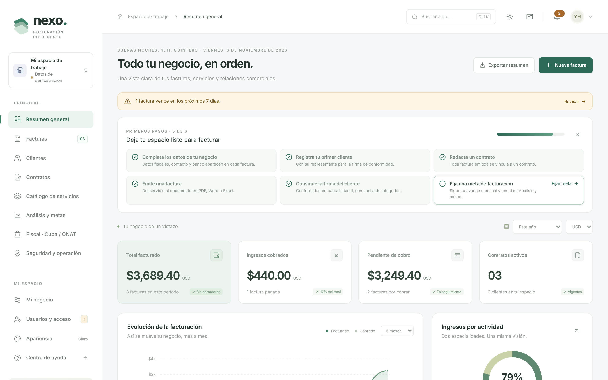<br /><sub><b>Resumen general</b>: facturado, cobrado, pendiente, avisos y primeros pasos.</sub></td>
    <td width="50%" valign="top">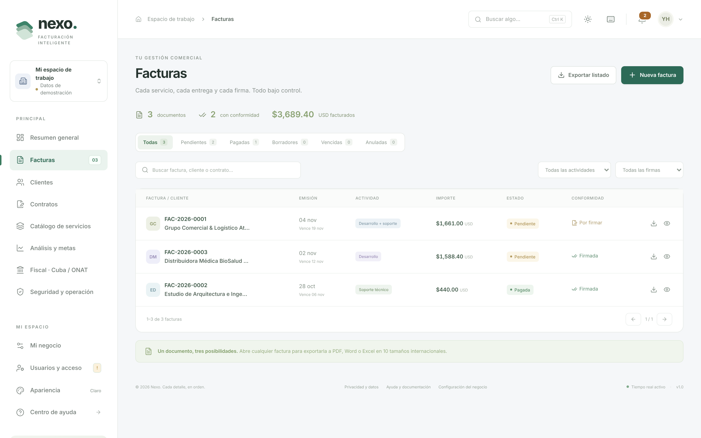<br /><sub><b>Facturas</b>: filtros por estado, conformidad, cliente y moneda.</sub></td>
  </tr>
  <tr>
    <td width="50%" valign="top">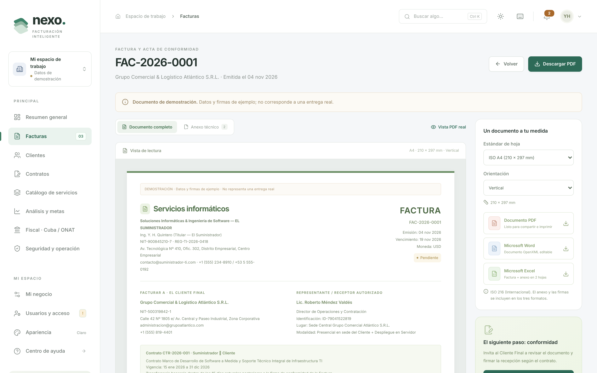<br /><sub><b>Factura y acta de conformidad</b>: tamaño de hoja, orientación y exportación.</sub></td>
    <td width="50%" valign="top">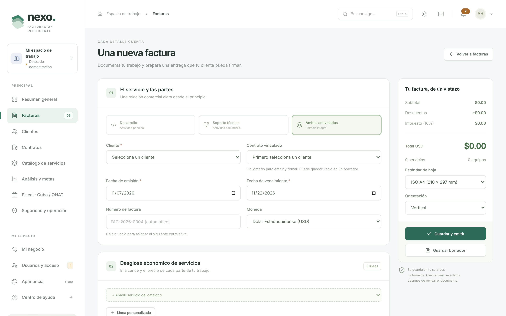<br /><sub><b>Nueva factura</b>: desde el contrato, con servicios del catálogo y desglose técnico.</sub></td>
  </tr>
  <tr>
    <td width="50%" valign="top">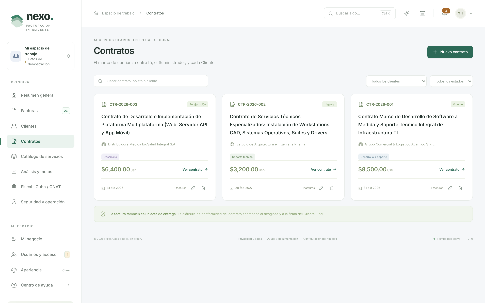<br /><sub><b>Contratos</b>: vigencia, cliente contratante y facturación del contrato.</sub></td>
    <td width="50%" valign="top">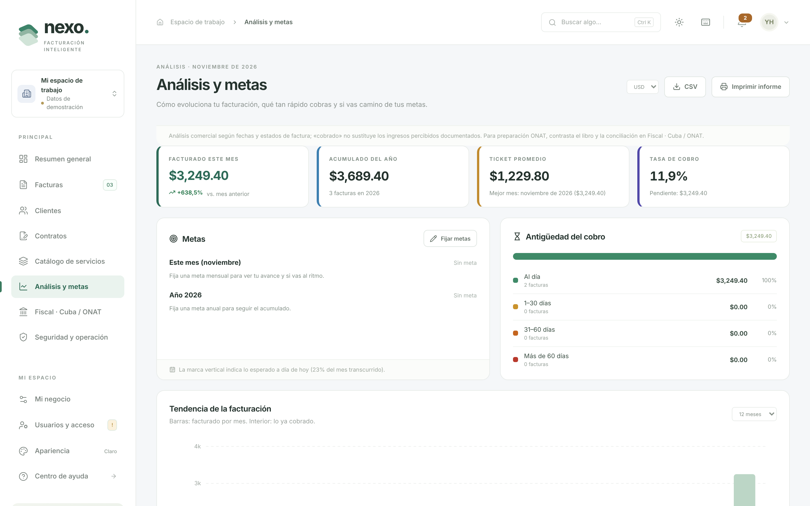<br /><sub><b>Análisis y metas</b>: tendencia, antigüedad del cobro y avance de metas.</sub></td>
  </tr>
  <tr>
    <td width="50%" valign="top">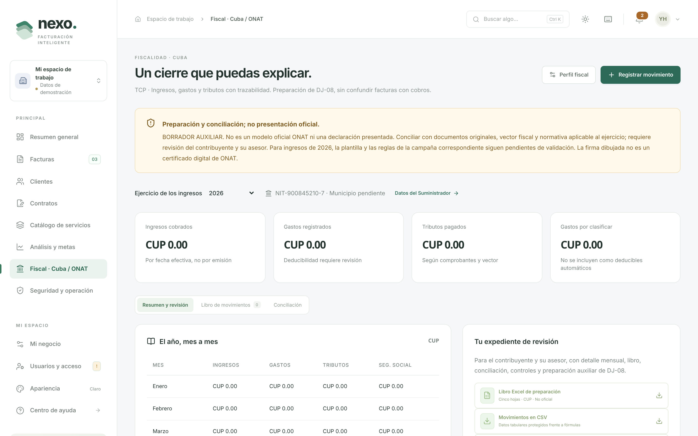<br /><sub><b>Fiscal · Cuba / ONAT</b>: movimientos, resumen mensual, conciliación y auxiliares.</sub></td>
    <td width="50%" valign="top">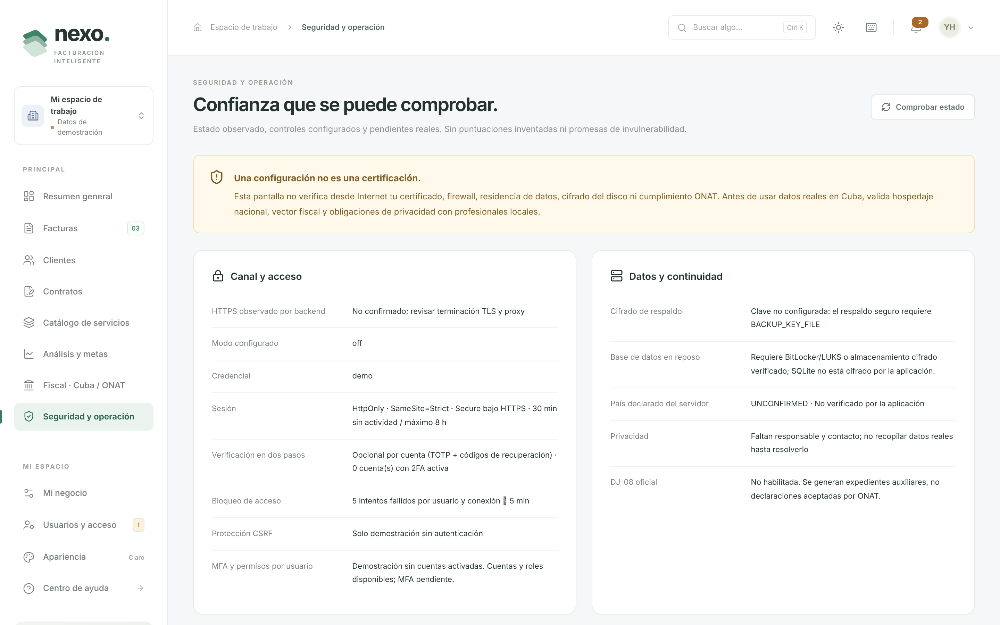<br /><sub><b>Seguridad y operación</b>: HTTPS, cabeceras, copias y comprobaciones.</sub></td>
  </tr>
  <tr>
    <td width="50%" valign="top">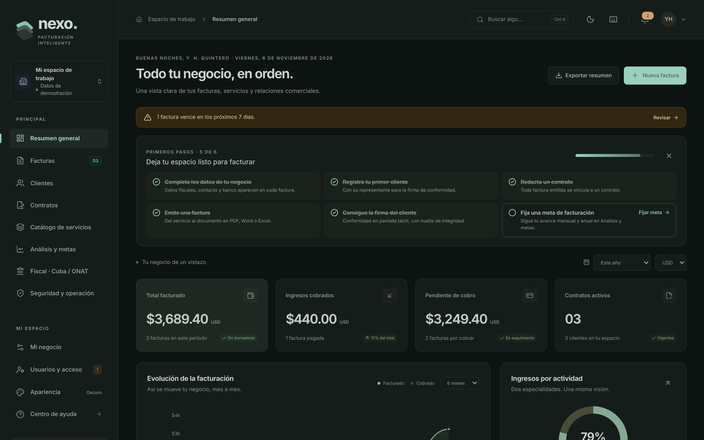<br /><sub><b>Modo oscuro</b>: el mismo Resumen con el tema oscuro.</sub></td>
    <td width="50%" valign="top" align="center">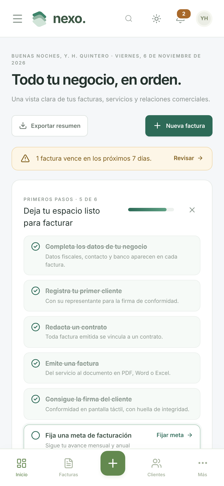<br /><sub><b>En el móvil</b>: navegación inferior, instalable como app.</sub></td>
  </tr>
</table>

---

## ⚙️ Requisitos

| Para | Necesitas |
|---|---|
| Servidor | **Node.js 22.13 o superior** (incluye SQLite) y npm. |
| Inicio recomendado en Windows | **PowerShell 7.4+** y **[Caddy](https://caddyserver.com)** oficial (el panel lo comprueba y explica cómo instalarlo con `winget`). |
| Usuarios | Navegador actual: Chrome, Edge, Firefox o Safari, en escritorio o móvil. |
| Red local | IP privada fija del servidor y confianza explícita en la CA local en cada dispositivo. |

---

## 🚀 Inicio rápido

### Windows: HTTPS con el panel PowerShell (recomendado)

Desde la raíz del proyecto:

```powershell
# Local: inicia Web + API + tiempo real + HTTPS y abre el navegador.
pwsh -NoProfile -File .\control\Panel-Sistema.ps1 -InstallDependencies

# Primera inicialización para usarlo desde el móvil en la red local (cambia por TU IP privada fija).
pwsh -NoProfile -File .\control\Panel-Sistema.ps1 -Mode LAN -LanAddress 192.168.1.20 -InstallDependencies

# Menú y operaciones posteriores:
pwsh -NoProfile -File .\control\Panel-Sistema.ps1 -Action Menu
pwsh -NoProfile -File .\control\Panel-Sistema.ps1 -Action Stop
pwsh -NoProfile -File .\control\Panel-Sistema.ps1 -Action Backup
pwsh -NoProfile -File .\control\Panel-Sistema.ps1 -Action ExportService
```

- El modo elegido se conserva tras inicializar.
- El panel pide la frase del administrador **sin mostrarla**, guarda su hash scrypt y una clave independiente para las copias en un estado privado, y valida sus propios procesos y el HTTPS.
- No abre el router ni instala la CA en silencio: **cada PC o teléfono debe confiar explícitamente en la CA local** tras verificar su huella.
- Publicarlo en Internet exige dominio, DNS, ACME y un hospedaje permitido; no se hace automáticamente. Lee [operación segura](docs/OPERACION-SEGURA.md) antes de usar datos reales.

### Laboratorio con datos de demostración

```powershell
npm ci
# Solo datos ficticios (no reutilices una base real):
$env:TLS_MODE='off'; $env:SEED_DEMO='true'; $env:HOST='127.0.0.1'
npm run dev
```

### Producción con Node o Docker

`.env.example` describe una producción protegida: adapta el origen, la IP exacta del proxy, los archivos de secretos, el responsable y el país físico confirmado. No uses `TRUST_PROXY=1`. El panel gestiona su propia configuración privada y no carga `.env`. `compose.yaml` es una plantilla todavía sin ejecución local verificada.

---

## 👥 Roles y permisos

Cada persona entra con **su usuario y su contraseña**. En la primera inicialización el panel crea `admin` con la frase introducida. **Una base que ya tiene cuentas conserva sus usuarios, hashes y roles:** la credencial de arranque no sustituye contraseñas ni permite saltarse el acceso. No borres ni recrees la base para actualizar.

| Acción | Administrador | Gestor | Técnico | Solo lectura |
|---|:-:|:-:|:-:|:-:|
| Consultar datos comerciales y descargar facturas | ✅ | ✅ | ✅ | ✅ |
| Preparar borradores y recoger la firma asistida | ✅ | ✅ | ✅ | — |
| Clientes, contratos, catálogo y ciclo de emisión, cobro y anulación | ✅ | ✅ | — | — |
| Perfil del Suministrador, usuarios, copias y estado de seguridad | ✅ | — | — | — |
| Consultar y exportar auxiliares fiscales | ✅ | ✅ | — | ✅ |
| Perfil fiscal, movimientos y reversiones | ✅ | ✅ | — | — |

- El administrador invita desde **Usuarios y acceso**, asigna el rol y entrega la contraseña temporal por un canal seguro. Hasta elegir una propia, la cuenta no puede operar. Siempre queda al menos un administrador activo.
- **Mi cuenta** permite cambiar la contraseña, activar la verificación en dos pasos y cerrar otras sesiones.
- Ni siquiera un administrador puede reescribir una factura emitida o firmada.
- Todos los roles pertenecen al **mismo negocio**; no son cuentas aisladas para clientes.

**Recuperación local:** en el servidor, con `DATA_DIR` apuntando a la base correcta:

```bash
npm run user:reset-password -- <usuario> [--admin | --reset-2fa]
```

Genera una contraseña temporal, la muestra una sola vez y cierra las sesiones de esa cuenta. Requiere acceso al sistema operativo; no es un servicio público. Cambiar `APP_PASSWORD` **no** restablece cuentas existentes. Ver [cuentas personales y recuperación](docs/OPERACION-SEGURA.md#cuentas-personales-y-recuperación).

---

## 🔒 Seguridad

| Capa | Medidas |
|---|---|
| **Transporte** | HTTPS directo (TLS 1.2/1.3) o proxy Caddy restringido, HSTS. En producción el servidor no arranca por HTTP salvo la excepción de laboratorio en loopback. |
| **Acceso** | scrypt con sal, contraseñas de 14 a 1024 caracteres, **2FA TOTP** con 10 códigos de recuperación, `REQUIRE_ADMIN_2FA`, **bloqueo de 5 minutos tras 5 intentos** que persiste tras reinicios. |
| **Sesiones** | Cookie HttpOnly, SameSite Strict y Secure; token CSRF por sesión; cierre por inactividad a los 30 minutos con aviso previo; máximo 8 horas; **Mis sesiones** para cerrar otros dispositivos. |
| **Aplicación** | Permisos comprobados en el servidor en cada solicitud, CSP estricta, validación con Zod, límites de acceso y exportación, errores saneados y registros sin contraseñas ni cuerpos. |
| **Datos** | SQLite WAL, copias consistentes **AES-256-GCM** con clave separada, rotación (`BACKUP_KEEP`), copia diaria automática y restauración solo a un archivo nuevo. |
| **Integridad** | Copia fija de cada factura firmada con huella de contenido e historial de eventos. |

> La firma de conformidad no es una firma digital certificada ni identifica criptográficamente al firmante. Llaves de seguridad, SSO, aislamiento entre negocios, sellado externo y certificación siguen pendientes. Detalles en [SECURITY.md](SECURITY.md) y la [auditoría](docs/AUDITORIA-SEGURIDAD.md).

---

## ✅ Calidad y pruebas

Cada cambio pasa por la [integración continua](.github/workflows/ci.yml):

| Trabajo | Qué comprueba |
|---|---|
| **Linux** | `npm ci`, `npm audit`, TypeScript, compilación, pruebas unitarias y de API, inventario SBOM y recorridos completos en el navegador (Playwright). |
| **Windows** | Caddy real, análisis del panel PowerShell, permisos de archivos y pruebas Pester (`tests/powershell/Panel.Tests.ps1`). |

```bash
npm run typecheck     # TypeScript sin errores
npm run build         # compilación sin avisos
npm test              # dominio, API, TLS, seguridad, 2FA, copias, fiscal y paquete
npx playwright install chromium
npm run test:e2e      # recorridos completos en el navegador
npm audit
```

---

## 📁 Estructura del proyecto

```text
control/                 Panel PowerShell y módulo operativo de Windows
deploy/                  Caddyfile del proxy HTTPS
server/                  API Express, base de datos, tiempo real y exportaciones
  security/              Sesiones y CSRF, scrypt, cabeceras, registros, copias cifradas
  fiscal/                Libro, conciliación, validaciones y auxiliares ONAT
src/                     Aplicación Web (React)
  views/                 Pantallas: resumen, facturas, contratos, fiscal, seguridad…
  components/            Piezas reutilizables: 2FA, sesiones, copias, firma…
shared/                  Modelos, textos oficiales, decimales y tamaños de papel
scripts/                 Hash de contraseña, claves, copias, descifrado, sondeo HTTPS, capturas
tests/                   Pruebas de dominio, API, seguridad, fiscal, navegador y PowerShell
docs/                    Documentación y sitio de GitHub Pages
```

No se guardan datos ni secretos en Git. Antes de mover una base con WAL, consulta los procedimientos de recuperación y migración.

---

## 📚 Documentación

| Documento | Contenido |
|---|---|
| [Operación segura](docs/OPERACION-SEGURA.md) | Inicio HTTPS, confianza en red local y móvil, Internet, panel, copias, recuperación y Docker. |
| [Alcance fiscal Cuba / ONAT](docs/ONAT-CUBA.md) | TCP 2026, auxiliares y bloqueos de la DJ-08 y otros informes. |
| [Auditoría de seguridad](docs/AUDITORIA-SEGURIDAD.md) | Marco jurídico y técnico, estándares, capas, hallazgos, plan y balance. |
| [Verificaciones](docs/VERIFICACION.md) | Evidencia de la CI y límites de lo comprobado. |
| [SECURITY.md](SECURITY.md) | Cómo informar de vulnerabilidades y lista para producción. |
| [CONTRIBUTING.md](CONTRIBUTING.md) | Entorno, flujo de trabajo y estilo. |
| [CHANGELOG.md](CHANGELOG.md) | Historial de versiones. |

---

## ❓ Preguntas frecuentes

<details>
<summary><b>¿Nexo presenta mis declaraciones a la ONAT?</b></summary>

No. Nexo prepara auxiliares (XLSX, CSV y ZIP) y un resumen mensual para que los revises. La DJ-08 oficial y la presentación siguen bloqueadas hasta verificar el modelo del ejercicio. El análisis comercial por estado de factura no sustituye los cobros ni los asientos del libro fiscal. Ver [docs/ONAT-CUBA.md](docs/ONAT-CUBA.md).
</details>

<details>
<summary><b>¿Funciona sin Internet?</b></summary>

Sí, en tu red local: el servidor corre en tu equipo y los móviles se conectan por HTTPS a su IP privada. La PWA guarda la interfaz, pero **no** permite editar sin conexión con el servidor ni guarda datos fiscales en la caché del navegador.
</details>

<details>
<summary><b>¿Cómo lo uso desde el móvil?</b></summary>

Inicia el panel en modo `LAN` con la IP fija del servidor, confía en la CA local del teléfono tras verificar su huella, abre la dirección HTTPS y elige «Instalar» o «Añadir a pantalla de inicio».
</details>

<details>
<summary><b>¿La firma del cliente tiene validez legal?</b></summary>

Es una firma de conformidad con consentimiento, copia fija del documento y huella de contenido. No es una firma digital certificada ni autentica al firmante de forma independiente. Valora con tu asesor si basta para tu contrato.
</details>

<details>
<summary><b>Perdí el teléfono con la verificación en dos pasos.</b></summary>

Entra con uno de tus códigos de recuperación («¿Sin teléfono? Usa un código de recuperación»). Si no los tienes, otro administrador puede restablecerla desde **Usuarios y acceso**, o en el servidor: `npm run user:reset-password -- <usuario> --reset-2fa`.
</details>

<details>
<summary><b>¿Cómo restauro una copia?</b></summary>

Las copias `.nxb` se descifran con `npm run backup:decrypt` **a un archivo nuevo**; nunca sobrescriben la base activa. Ensaya la restauración con regularidad y guarda la clave fuera del directorio de copias. Ver [operación segura](docs/OPERACION-SEGURA.md).
</details>

<details>
<summary><b>¿Puedo actualizar sin perder datos?</b></summary>

Sí. Las actualizaciones migran la base existente y conservan cuentas, contraseñas y roles. No borres ni recrees la base para actualizar.
</details>

---

## 🤝 Contribuir

Las propuestas son bienvenidas mediante issues y pull requests. Lee [CONTRIBUTING.md](CONTRIBUTING.md) y usa las plantillas. Para vulnerabilidades, **no abras un issue público**: sigue [SECURITY.md](SECURITY.md).

---

## 📄 Licencia

**Software propietario. Todos los derechos reservados.** © 2026 yhquintero.

Ver el código en GitHub no concede ningún derecho de uso: instalar Nexo en un negocio, copiarlo, modificarlo o distribuirlo requiere una licencia de uso del titular. Condiciones completas en [LICENSE](LICENSE). Los componentes de terceros conservan sus propias licencias: [THIRD_PARTY_NOTICES.md](THIRD_PARTY_NOTICES.md).

---

## 📝 Registro de cambios y hoja de ruta

Las novedades de cada versión están en [CHANGELOG.md](CHANGELOG.md). Próximos pasos:

- **Operación diaria:** papelera con restauración, cierre mensual de cobros, auditoría con búsqueda e importación de clientes y servicios desde Excel.
- **Guía y pulido visual:** recorrido guiado, ayudas contextuales, página legal, barra lateral oscura y mejoras de accesibilidad.

<div align="center">
<sub>Hecho con 💚 para quienes facturan su propio trabajo.</sub>
</div>
